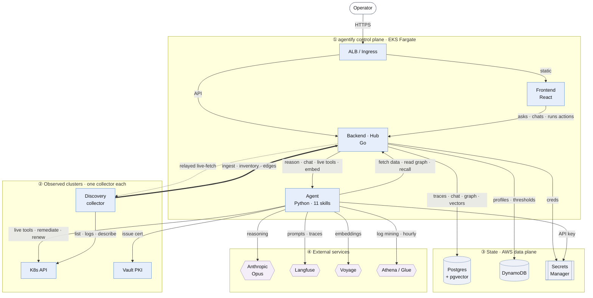

# ARCHITECTURE.md – Agentify runtime design and deployment

> This document describes the **runtime architecture** of agentify — how the system
> is layered, coded, deployed, and operates. It complements `context-mesh/` which
> describes the *product behavior* (policies, specs, decisions about what the
> system does). Start here to understand the implementation.

## 0. Critical traffic flow — the whole system in one picture



**Read it as a map of connections, not of requests.** Every connection appears
exactly once, labelled with what it carries. That is what keeps a single picture
legible: the 16 individual flows drawn as separate lanes would be ~90 edges. To
follow one flow end to end, open
[`docs/architecture-map.html`](docs/architecture-map.html), which overlays them
one at a time; for strict ordering, [`docs/SEQUENCE_FLOWS.md`](docs/SEQUENCE_FLOWS.md).

### What each connection actually carries

| Connection | Label | Endpoints |
|---|---|---|
| Operator → ALB | HTTPS | the ALB hostname is account-specific and changes when the ingress is recreated — never hardcode it |
| ALB → Frontend / Backend | static · API | `/` to the UI; `/api/*` and `/admin/*` to the Hub |
| Frontend → Backend | asks · chats · runs actions | `POST /api/query`, `POST /api/chat/sessions/{id}/messages`, `POST /api/live-query`, `POST /admin/remediation/{id}/approve`, `POST /admin/certs/renew` |
| Backend → Agent | reason · chat · live tools · embed | `POST /reason`, `POST /reason-chat`, `POST /live-tool-call`, `POST /embed` |
| Agent → Backend | fetch data · read graph · recall | `POST /api/agent/fetch`, `GET /api/service-dependencies`, `GET /api/incidents/similar`, `GET /api/resolve-cluster`, `GET /api/cluster-service-selectors`, `GET /admin/tracked`, `POST /api/live-fetch` |
| Backend → Postgres | traces · chat · graph · vectors | `traces`, `chat_sessions`, `service_dependencies`, `incident_embeddings` (pgvector), `cluster_services` |
| Backend → DynamoDB | profiles · thresholds | pod profiles and tuning values, kept out of code |
| Backend / Agent → Secrets Manager | creds · API key | DB credentials, collector tokens, the Anthropic key. **Updating a secret does not reach a running pod** — the value is read from env, sourced from a K8s Secret only the deploy workflow recreates |
| Agent → Anthropic | reasoning | one Opus call per Pattern-A skill; 1–N for the Pattern-B loop; **zero** for every deterministic path |
| Agent → Langfuse | prompts · traces | prompts are resolved per request by label, not baked into the image; one observation per call or chat turn |
| Agent → Voyage | embeddings | 512-dim vector per diagnosis, for semantic recall |
| Agent → Athena/Glue | log mining · hourly | the centralized dependency miner, scanning the current hour partition |
| Agent → K8s API | live tools · remediate · renew | live reads, approved remediation, TLS Secret writes |
| Agent → Vault | issue cert | PKI engine, on demand |
| Collector → K8s API | list · logs · describe | 5 pods per namespace, last 200 log lines per scan |
| **Collector → Backend** (bold) | ingest · inventory · edges | `GET /api/collector/connect` (outbound WSS), `POST /api/ingest`, `/api/cluster-inventory`, `/api/cluster-health`, `/api/cluster-ingress`, `/api/service-dependencies` |
| Backend ⇢ Collector (dotted) | relayed live-fetch | the Hub **never dials a cluster**. It answers down the socket the collector opened, so no inbound access or cross-account credential is ever needed |

### The five critical paths through it

| # | Path | Route | Model calls |
|---|---|---|---|
| 1 | **Ask — fast path** | Operator → ALB → FE → BE → Postgres → BE → FE | **0** — answered deterministically |
| 2 | **Ask — reasoned** | … → BE → Agent ⇄ BE (parallel prefetch) → Langfuse → Anthropic → BE → Postgres → FE | **1** |
| 3 | **Chat** | FE → BE → Agent ⇄ BE (tool loop) → Anthropic ×2 → Langfuse → BE → Postgres | **2**, or **0** for a dependency question |
| 4 | **Continuous ingest** | Collector → K8s API → Collector → BE → Postgres, every 60s | **0** |
| 5 | **Act** | Agent proposes → BE → Postgres → *human approves* → BE → Agent → K8s API | **0** on the execute leg |

Latency and cost live almost entirely in paths 2 and 3. Paths 1, 4 and 5 touch no
model at all — which is the point of [ADR 0006](context-mesh/decisions/0006-two-tier-query-path.md)
and of every deterministic skill since.

## 1. Runtime architecture (layers and data flow)

```
┌──────────────────────────────────────────────────────────────────┐
│              Frontend Layer                                      │
│  ┌───────────────────┐        ┌──────────────────────────────┐  │
│  │  Ops Dashboard    │        │  Admin Config UI            │  │
│  │  (React)          │        │  (React)                     │  │
│  │  - Chat interface │        │  - Add/edit integrations     │  │
│  │  - Quick queries  │        │  - Manage data sources       │  │
│  │  - Status view    │        │  - View adapter logs         │  │
│  └───────────────────┘        └──────────────────────────────┘  │
└────────────────────────────────┬─────────────────────────────────┘
                                 │ WebSocket + REST
┌────────────────────────────────▼─────────────────────────────────┐
│              API Gateway Layer (AWS ALB)                         │
│              - SSL termination                                   │
│              - Path-based routing                                │
│              - Rate limiting                                     │
└────────────────┬────────────────────────┬───────────────────────┘
                 │                        │
    ┌────────────▼───────────┐  ┌────────▼──────────────────┐
    │  Backend Core (Go)     │  │  Agent Layer (Python)    │
    │  - Orchestrator        │  │  - Claude SDK            │
    │  - API handlers        │  │  - System prompts        │
    │  - WebSocket handler   │  │  - Tool calling          │
    │  - Pod registry mgmt   │  │  - Reasoning             │
    └────────┬───────────────┘  └────────┬──────────────────┘
             │                           │
    ┌────────▼───────────────────────────▼──────────────┐
    │  Event Processing & Routing                      │
    │  - SQS queue (async tasks)                       │
    │  - Event normalizer                              │
    │  - Pod ingestion layer (spec 001)                │
    └────────┬──────────────────────────────────────────┘
             │
    ┌────────▼──────────────────────────────────────────┐
    │  Adapter Workers (Python / Go)                    │
    │  - K8s event watcher                              │
    │  - CRM sync (future)                              │
    │  - Webhook receiver                               │
    │  - Certificate scraper                            │
    └────────┬──────────────────────────────────────────┘
             │
    ┌────────▼──────────────────────────────────────────┐
    │  Storage Layer (Managed AWS services)             │
    │  ┌───────────────────────────┬──────────────────┐  │
    │  │ RDS Postgres + pgvector  │ DynamoDB         │  │
    │  │ (relational + KV + vec,  │ (pod registry,   │  │
    │  │  single store — ADR 0010)│  profiles)        │  │
    │  ├───────────────────────────┼──────────────────┤  │
    │  │ S3                        │ Secrets Manager  │  │
    │  └───────────────────────────┴──────────────────┘  │
    └───────────────────────────────────────────────────┘
    (Redis, Pinecone, Weaviate were the original plan below in sections
    4/8 — never adopted; ADR 0010 consolidated onto one Postgres first.)
             │
    ┌────────▼──────────────────────────────────────────┐
    │  Refinement Loop (observer + decision engine)     │
    │  - Monitor query patterns & stats                 │
    │  - Decide on pod splits/merges/migrations         │
    │  - Execute decisions (async)                      │
    └──────────────────────────────────────────────────┘
             │
    ┌────────▼──────────────────────────────────────────┐
    │  Observability                                    │
    │  - CloudWatch Logs (structured JSON)              │
    │  - CloudWatch Metrics + Alarms                    │
    │  - X-Ray distributed tracing                      │
    └──────────────────────────────────────────────────┘
```

## 2. Code structure (`src/` folder layout)

> **Note (2026-10-18):** this section was the original day-one sketch and
> had drifted significantly out of date — wrong storage subdirectories,
> missing packages, and a whole ingestion pipeline (`adapters/k8fy/`) that
> was deleted in commit `fe2aee4a` (ADR 0027). Rewritten below to match the
> actual tree. Section 0 above was already accurate; this just catches
> section 2 up to it.

```
src/
├── backend/                        # Go application
│   ├── cmd/
│   │   ├── agentify/main.go              # entry point
│   │   └── migrate-integration-tokens/   # one-time token migration (ADR 0025)
│   ├── internal/
│   │   ├── api/                    # HTTP handlers + fleet/chat/remediation logic
│   │   │   ├── handlers.go         # most endpoint handlers (/api/query, /api/chat/*, admin/*)
│   │   │   ├── router.go           # route registration (paths/methods)
│   │   │   ├── middleware.go       # request logging + metrics (no auth yet — TODO in code)
│   │   │   ├── websocket.go        # chat WebSocket handler
│   │   │   ├── agent_client.go     # HTTP client to the Python agent service
│   │   │   ├── collector_hub.go    # Discovery connection registry + live-fetch relay (ADR 0022)
│   │   │   ├── investigator.go     # proactive investigation sweep (spec 009)
│   │   │   ├── remediation.go / deployment_guardian.go / security_engagements.go
│   │   │   ├── dependency_chat_diff.go   # Tier A drift diff (ADR 0044)
│   │   │   ├── eval_query.go       # POST /admin/eval/query (ADR 0030)
│   │   │   └── types.go            # shared interfaces (ChatStore, etc.)
│   │   ├── orchestrator/           # query routing + tier selection
│   │   │   ├── router.go           # Router: pod registry + backend factory
│   │   │   ├── query_executor.go   # fetch data for a routed query
│   │   │   ├── config.go
│   │   │   └── evaluator/          # Tier-1 deterministic rules (PodHealth/ServiceStatus/CertRenewal — spec 003)
│   │   ├── models/                 # domain models
│   │   │   ├── pod.go, event.go, integration.go
│   │   │   └── shard.go            # models.PodID — cluster-aware pod-ID shape (ADR 0024)
│   │   ├── storage/
│   │   │   ├── postgres/           # postgres.go — THE store: backs relational + KV + pgvector (ADR 0010)
│   │   │   ├── registry/           # pod-registry cache fronting DynamoDB (ADR 0012)
│   │   │   └── vector/             # weaviate.go — written, never wired up; "vector" store type is
│   │   │                           # unprovisioned by design (storage/backend.go says so explicitly)
│   │   ├── config/                 # env.go, pod_profiles.go (event profiles from context-mesh)
│   │   ├── governance/             # Redactor — egress allowlist/denylist (ADR 0007)
│   │   ├── ingestion/               # Ingester — event → pod routing (spec 001)
│   │   ├── retention/               # Janitor — events/buckets/callers retention sweeps
│   │   ├── secrets/                 # Secrets Manager wrapper (ADR 0025)
│   │   └── telemetry/               # metrics.go — Prometheus counters (ADR 0011)
│   ├── go.mod
│   └── go.sum
│
├── agent/                          # Python application (FastAPI, :8001)
│   ├── main.py, app.py             # entry point + /reason, /reason-chat, /embed endpoints
│   ├── metrics.py                  # Prometheus token-usage metrics (ADR 0011)
│   ├── k8fy/
│   │   ├── agent.py                # K8fyAgent base: _reason_pattern_a(), _fetch(), reason_chat()
│   │   ├── prompt_manager.py       # Langfuse-first prompt resolver; local fallback
│   │   ├── prompts.py              # local fallback strings (docs/PROMPT_LIFECYCLE.md)
│   │   ├── tools.py                # Claude tool definitions — source of truth for the full list
│   │   ├── service_topology.py     # resolve_service_clusters, dependency-graph helpers
│   │   ├── dependency_miner.py / splunk_dependency_miner.py   # Glue/Athena + Splunk dependency mining
│   │   ├── log_router.py / log_platform.py / log_platform_splunk.py / log_redaction.py
│   │   ├── live_diagnostics.py, trace_search.py, tracing.py, action_executor.py
│   │   └── skills/                 # spec 010 — Pattern A skill router (ADR 0026)
│   │       ├── router.py           # SkillRouter: intent → skill dispatch table (13 entries today)
│   │       ├── health_check.py, cert_audit.py, change_history.py, restart_trend.py, diagnose.py
│   │       ├── vault_cert.py, incident_responder.py, remediation_executor.py, deployment_guardian.py
│   │       └── dependency_graph.py, cold_services.py, label_scoped_dependency.py
│   ├── scripts/migrate_prompts_to_langfuse.py
│   ├── models/response.py          # Pydantic AgentResponse, etc.
│   ├── config/settings.py, claude_client.py
│   ├── requirements.txt
│   └── Dockerfile
│
├── adapters/                       # Integration adapters
│   ├── discovery/                  # agentify-discovery: deterministic, non-agentic,
│   │   │                           # one Deployment PER FLEET CLUSTER (ADR 0022/0027).
│   │   │                           # Replaced the old adapters/k8fy/ entirely (deleted,
│   │   │                           # commit fe2aee4a) — no SQS/EventBridge anywhere here;
│   │   │                           # it pushes over plain HTTP + holds one outbound WSS.
│   │   ├── main.py, config.py, k8s_client.py
│   │   ├── inventory.py, ingress.py, health.py, health_snapshot.py, service_index.py
│   │   ├── service_topology.py, watch.py, normalize.py, security_posture.py
│   │   ├── live_relay.py, live_tools.py   # the persistent connection + on-demand relay side
│   │   └── log_redaction.py
│   └── security_verifier/          # active-verification adapter (ADR 0033)
│
├── frontend/                       # TypeScript / React (plain React + @tanstack/react-query;
│   │                                # no state-management library or component kit adopted)
│   ├── src/
│   │   ├── components/             # ChatPanel, TopologyPanel, DependencyFlow, DiagnosisReport,
│   │   │                           # SecurityPosturePanel, RemediationPanel, TracesPanel, etc.
│   │   ├── api.ts                  # API client
│   │   ├── App.tsx, main.tsx
│   │   └── styles.css
│   ├── package.json
│   └── vite.config.ts
│
├── infra/
│   ├── terraform/aws/              # eks.tf, iam.tf, rds.tf, dynamodb.tf, secrets.tf, logging.tf, …
│   └── kubernetes/                 # backend.yaml, agent.yaml, discovery.yaml, …
│
└── (tests live beside the code they test: *_test.go next to .go files,
    test_*.py under src/agent/tests/ and src/adapters/discovery/tests/,
    plus src/backend/tests/integration/ for cross-component tests)
```

## 3. Layer responsibilities and communication

### Backend (Go)

**Responsible for:**
- HTTP routing, WebSocket connections
- Query intent parsing
- Orchestration: route query → pod(s)
- Correlation: combine results from multiple pods
- Response formatting
- Admin CRUD for integrations

**Communications:**
- Receives HTTP/WebSocket from frontend
- Calls Python agent service (HTTP POST)
- Reads/writes pod storage (SQL, Redis, Pinecone, TSDB, logs)
- Emits events to SQS for async processing
- Reads pod-registry from DynamoDB

### Agent Layer (Python, containerized)

**Responsible for:**
- Claude SDK integration
- System prompt management
- Tool definition and calling
- Reasoning over data (health judgment, decisions)
- Response synthesis

**Communications:**
- Receives POST requests from Go backend
- Calls Claude API (with prompt caching for cost savings)
- Returns structured JSON response
- Logs reasoning steps to CloudWatch

### Adapters (Python / Go)

**Responsible for:**
- Source system integration (K8s API, CRM APIs, etc.)
- Event normalization (to canonical format)
- Emission to ingestion layer

**Communications:**
- Poll SQS for tasks or run on schedule
- Call external APIs (K8s, Salesforce, etc.)
- Emit canonical events to ingestion queue
- Log errors and metrics to CloudWatch

### Refinement Loop (Python or Go)

**Responsible for:**
- Monitor query patterns (from pod stats)
- Detect split/merge/migrate opportunities
- Execute decisions (async)

**Communications:**
- Reads stats from pod storage layer
- Reads pod-registry from DynamoDB
- Emits decisions to SQS
- Updates pod-registry when changes complete

## 4. AWS deployment architecture

> **Note (2026-10-18):** this section originally described ADR 0004's ECS
> Fargate placement. [ADR 0017](context-mesh/decisions/0017-all-on-eks-topology.md)
> (2026-06-06) superseded that with a single EKS cluster for backend +
> agent + Discovery; see `infra/terraform/aws/eks.tf` and
> `infra/kubernetes/*.yaml`. Rewritten below to match. This also drops
> ElastiCache/Pinecone, which section 1 above already corrected (ADR 0010 —
> neither was ever provisioned).

```
┌─────────────────────────────────────────────────────────────┐
│                    AWS Account                              │
├─────────────────────────────────────────────────────────────┤
│
│  ┌─────────────────────────────────────────────────────────┐
│  │  Networking & CDN                                       │
│  │  - Route 53 (DNS)                                       │
│  │  - CloudFront (CDN for frontend, served from S3)        │
│  │  - ALB (Application Load Balancer, ingress into EKS)    │
│  │  - VPC (with public + private subnets)                  │
│  └────────────────────┬────────────────────────────────────┘
│                       │
│  ┌────────────────────▼────────────────────────────────────┐
│  │  EKS Cluster (single cluster, all compute — ADR 0017)   │
│  │  ┌─────────────────────────────────────────────────────┐
│  │  │ Deployment: Backend (Go) — svc/agentify-backend     │
│  │  │ - Min 2 pods (HA), auto-scale on CPU                │
│  │  └─────────────────────────────────────────────────────┘
│  │  ┌─────────────────────────────────────────────────────┐
│  │  │ Deployment: Agent (Python) — svc/agentify-agent     │
│  │  └─────────────────────────────────────────────────────┘
│  │  ┌─────────────────────────────────────────────────────┐
│  │  │ Deployment: agentify-discovery                      │
│  │  │ - one per FLEET cluster (ADR 0022) — pushes          │
│  │  │   inventory/edges to the Hub, holds one outbound     │
│  │  │   WSS for on-demand live reads; no SQS/EventBridge   │
│  │  └─────────────────────────────────────────────────────┘
│  └─────────────────────────────────────────────────────────┘
│
│  ┌─────────────────────────────────────────────────────────┐
│  │  Data Services (Managed)                                │
│  │  ┌──────────────────────────────┬─────────────────────┐ │
│  │  │ RDS Postgres + pgvector      │ DynamoDB            │ │
│  │  │ - Multi-AZ                   │ - Pod registry      │ │
│  │  │ - backs relational + KV +    │ - Integrations      │ │
│  │  │   vector, single store       │ - Configs/profiles  │ │
│  │  │   (ADR 0010)                 │                      │ │
│  │  └──────────────────────────────┴─────────────────────┘ │
│  │  ┌──────────────────┬──────────────────────────────────┐ │
│  │  │ S3 (Storage)     │ Secrets Manager                   │ │
│  │  │ - Pod registry   │ - Collector/DB/Anthropic creds    │ │
│  │  │   backups        │ - read from env, K8s Secret only  │ │
│  │  └──────────────────┴──────────────────────────────────┘ │
│  └─────────────────────────────────────────────────────────┘
│
│  ┌─────────────────────────────────────────────────────────┐
│  │  Observability                                          │
│  │  - CloudWatch Logs (all services)                       │
│  │  - CloudWatch Metrics (custom metrics)                  │
│  │  - CloudWatch Alarms (high error rate, slow queries)    │
│  │  - X-Ray (optional: distributed traces)                 │
│  └─────────────────────────────────────────────────────────┘
│
└─────────────────────────────────────────────────────────────┘
```

**Cost (per ADR 0017's own accounting):**
- EKS control plane: ~$73/month flat, regardless of node count
- Worker nodes + RDS + DynamoDB + S3 + data transfer: scales with load
- See `docs/DEPLOYMENT.md` for the current, maintained cost table — this
  section no longer carries its own numbers to avoid a second copy drifting
  out of sync with that one.

## 5. Integration flow (end-to-end, as actually built)

> **Note (2026-10-18):** this section originally described a K8s Adapter
> polling via EventBridge and emitting to an SQS ingestion queue. That
> component (`adapters/k8fy/`) was deleted outright in commit `fe2aee4a`
> (ADR 0027) and replaced by `agentify-discovery` — no SQS, no EventBridge,
> no separate "Event Ingestion Service" anywhere in this path. Rewritten
> below to match what actually runs.

```
1. agentify-discovery (one Deployment PER FLEET CLUSTER, on a 60s timer)
   │
   ├─► Calls its OWN cluster's K8s API directly (inventory.py, ingress.py,
   │   service_topology.py, health_snapshot.py) — no queue, no schedule
   │   service; it's a plain in-process timer loop (main.py)
   │
   └─► Pushes straight over HTTP to the Hub (plain POST, bearer
       CollectorToken — resolveTenantContext identifies tenant/cluster):
       POST /api/ingest, /api/cluster-inventory, /api/cluster-health,
       /api/cluster-ingress, /api/service-dependencies
       │
       ▼
2. Go backend (the Hub) — handlers.go
   │
   ├─► resolveTenantContext authenticates the push, resolves (tenant_id, cluster_id)
   │
   ├─► Writes straight into Postgres (ADR 0010 — one store backs
   │   relational + KV + vector): current_state, events, cluster_services,
   │   service_dependencies, cluster_health_snapshots
   │
   └─► Updates pod-registry stats in DynamoDB (via internal/storage/registry)
       │
       ▼
3. On-demand live reads (separate from the push path above): Discovery also
   holds ONE persistent outbound WebSocket to the Hub (GET
   /api/collector/connect). When the agent needs a live K8s read (pod logs,
   events, certs), the Hub relays the request down that socket
   (CollectorHub / POST /api/live-fetch) and Discovery answers it directly
   against its own cluster — the Hub never dials a cluster itself.
       │
       ▼
4. Frontend / operator: queries via the Go backend
   │
   ├─► GET /admin/integrations → list of fleet clusters, last push, status
   │
   ├─► POST /api/query "health of service X"
   │   → orchestrator routes to the right Postgres-backed pod
   │   → calls the Python agent (Skill Router → Pattern A skill) for reasoning
   │   → returns answer with sources + confidence
```

## 6. Admin interface configuration flow

```
Admin User → Frontend (React) → Go API → DynamoDB

1. POST /admin/integrations
   {
     "name": "Prod K8s Cluster",
     "type": "kubernetes",
     "config": {
       "api_endpoint": "https://k8s-prod.internal:6443",
       "auth_type": "bearer_token",
       "token_secret_arn": "arn:aws:secretsmanager:...",
       "namespaces": ["prod", "staging"],
       "scrape_interval": "30s"
     }
   }

2. Go backend:
   - Validates config (format, required fields)
   - Stores in DynamoDB (integrations table)
   - Stores secret token in Secrets Manager
   - Emits event: "integration_added" → SQS
   - Returns 201 Created

3. SQS consumer (or EventBridge):
   - Reads event
   - Spins up K8s adapter container if not running
   - Adapter reads config from DynamoDB
   - Adapter runs first scrape
   - Updates status in DynamoDB: "active" + "last_heartbeat"

4. Frontend polls:
   - GET /admin/integrations/k8s-prod-cluster-01
   - Shows status (active | error), last heartbeat, event count
```

## 7. Chat interface flow (ops user interaction)

```
Ops User (browser) → React Frontend → Go WebSocket → Agent → Storage

1. User types in chat: "Is the payments service healthy?"

2. Frontend emits:
   {
     "type": "chat_message",
     "text": "Is the payments service healthy?",
     "context": {
       "namespace": "prod",
       "cluster": "us-west-2"
     }
   }

3. Go backend receives on WebSocket:
   - Parses intent: "health_check"
   - Routes query: "payments" → k8fy.live-state:prod pod
   - Fetches data from Redis
   - Calls Python agent: POST http://agent:8000/reason
     {
       "intent": "health_check",
       "data": { ... },
       "context": { ... }
     }

4. Python agent (Claude):
   - System prompt: "You are a Kubernetes expert..."
   - Data: pod phase, ready condition, restart count, events
   - Claude reasons: "This service is Healthy because..."
   - Returns: { "answer": "...", "status": "healthy", "confidence": 0.99 }

5. Go formats response and sends back over WebSocket:
   {
     "type": "response",
     "answer": "Service payments is Healthy...",
     "status": "healthy",
     "sources": ["k8fy.live-state:prod"],
     "confidence": 0.99,
     "actions": [
       { "label": "Show metrics", "action": "query_metrics" },
       { "label": "View events", "action": "query_events" }
     ]
   }

6. Frontend renders:
   - Status badge (green Healthy)
   - Answer text
   - Source pods (clickable for details)
   - Action buttons
```

## 8. Cost optimization strategies

| Scenario | Strategy |
|----------|----------|
| **Dev/Testing** | Minimal pod replicas for backend + agent; scale nodes to 0 off-hours (see `docs/DEPLOYMENT.md`'s "Pause" cost tier, ~$73/mo — the EKS control-plane floor). |
| **Production (low volume)** | 2 backend pods (HA), 1 agent pod, one `agentify-discovery` pod per fleet cluster. See `docs/DEPLOYMENT.md` for the current, maintained cost table. |
| **Production (scale)** | Auto-scaled backend/agent pods, RDS Multi-AZ, more fleet clusters (each adding one more Discovery pod, not a new compute tier). |
| **Reduce compute costs** | Cache query results (1 hour TTL); Discovery already scans on a fixed interval (60s) rather than per-event. |
| **Reduce storage costs** | Archive old events to S3 Glacier (after 30d); move cold data out of hot stores. |
| **Reduce agent costs** | Use Claude prompt caching (saves ~90% of repeated queries). |

## 9. Deployment & operations

See `infra/` folder and `docs/DEPLOYMENT.md` for:
- Terraform IaC (all AWS resources, including the EKS cluster itself — ADR 0017)
- Docker images (all services)
- Plain Kubernetes manifests (`infra/kubernetes/*.yaml`) — no Helm chart exists
- Monitoring & alerting
- Runbooks (incident response — also `docs/CLOUDSHELL_RUNBOOK.md`)

## 10. Future scaling (no major refactoring)

- **More adapters?** Add new service in `adapters/`; emit canonical events.
- **More integrations?** Add new pod types in `pods/`; register in pod-registry.
- **Multi-region?** Replicate RDS to standby region; use Route 53 failover.
- **On-prem deployment?** Docker Compose for single-node; k8s for scale.
